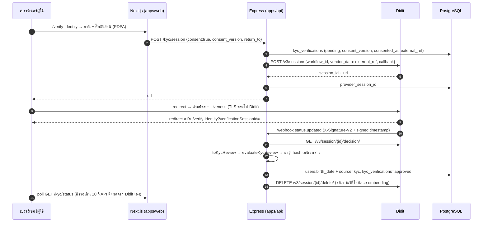

# ยืนยันอายุด้วยบัตร + สแกนใบหน้า (e-KYC / Age Verification)

ระบบยืนยันอายุของ BuddyBook ยอมรับเฉพาะแหล่งที่มีหลักฐาน (ไม่มีการกรอกวันเกิดเอง) — เกตเรตเนื้อหาใช้อายุจากแหล่งเหล่านี้ (`apps/api/src/lib/contentRating.ts`)

| แหล่ง (`users.age_verification_source`) | หลักฐาน | ปลดล็อก |
|---|---|---|
| `kyc` — บัตรประชาชน/พาสปอร์ต + Liveness + Face match (Didit) | เอกสารจริง + ใบหน้าคนจริงตรงกับบัตร | ทุกเรตตามอายุ |
| `google` — วันเกิดในบัญชี Google (People API) | บัญชี Google (Family Link คุมบัญชีเด็ก) | ทุกเรตตามอายุ |
| ยังไม่ยืนยัน | — | `all_ages` เท่านั้น |

`teen` ต้องอายุ ≥ 13, `mature` ต้องอายุ ≥ 18 · ผล `kyc` ทับ `google` ได้ แต่ไม่ย้อนกลับ
การกรอกวันเกิดเองถูกยกเลิก (migration `20261024140000_remove_self_declared_age` ลบอายุที่เคยกรอกเองออกทั้งหมด และ CHECK constraint `chk_users_age_verification_source` รับเฉพาะ `kyc` / `google`)

---

## 1. ผู้ให้บริการ

| ผู้ให้บริการ | จุดเด่น | ราคา (ตรวจสอบ ต.ค. 2026 — ยืนยันใน Console ก่อนใช้จริง) |
|---|---|---|
| **Didit** ✅ ที่ใช้ | รองรับบัตรประชาชนไทย (OCR อักษรไทย), ThaID, พาสปอร์ตไทย; Passive liveness (iBeta PAD L1) + Face match; มี API ลบ session (ภาพ/ชีวภาพ) ทันที | **ฟรี 500 ครั้ง/เดือน** (ID + Liveness + Face match + IP), เกินนั้นราว $0.30–0.33/ครั้ง ([didit.me/pricing](https://didit.me/pricing)); ตรวจกับทะเบียนราษฎร์ (DOPA) คิดแยก — ไม่ได้ใช้ |
| Sumsub | WebSDK ครบเครื่อง | $1.35/ครั้ง ขั้นต่ำ $149/เดือน — เคยต่อไว้แล้วเปลี่ยนเป็น Didit เพราะมีโควตาฟรี |
| iApp Technology (ไทย) | ข้อมูลอยู่ในไทย | คิดเครดิตต่อ request — ภาพต้องผ่าน backend เราเอง |

โค้ดที่คุยกับผู้ให้บริการอยู่ไฟล์เดียว `apps/api/src/lib/kyc/didit.ts` (แปลงผลเป็น `KycReview` กลาง) — เปลี่ยนเจ้าได้โดยเขียน client ใหม่ที่คืน `KycReview` แบบเดียวกัน

---

## 2. Architecture



| ชั้น | ไฟล์ |
|---|---|
| Provider client (session, decision, delete, webhook signature) | `apps/api/src/lib/kyc/didit.ts` |
| Validating age logic (pure) | `apps/api/src/lib/kyc/evaluate.ts` |
| Service / routes / webhook | `apps/api/src/modules/kyc/*`, webhook mount ใน `apps/api/src/app.ts` |
| เกตเรต | `apps/api/src/lib/contentRating.ts` |
| ตาราง | `kyc_verifications` (migrations `20261024120000_kyc_verifications`, `20261024160000_kyc_provider_session`) |
| หน้าเว็บ | `apps/web/src/app/verify-identity/page.tsx`, `components/kyc/*` |
| ข้อความยินยอม | `apps/web/src/lib/kycConsent.ts` (+ เลขฉบับใน `apps/api/src/lib/kyc/consent.ts`) |

| Method | Path | หน้าที่ |
|---|---|---|
| POST | `/api/v1/kyc/session` | ต้องล็อกอิน + `consent: true` + ฉบับปัจจุบัน → `url` หน้า Didit |
| GET | `/api/v1/kyc/status` | `none / pending / approved / rejected` + เหตุผล + ส่งใหม่ได้ไหม |
| DELETE | `/api/v1/kyc` | ถอนความยินยอม: ลบ session ที่ Didit + ข้อมูล e-KYC ของเรา + ยกเลิกอายุที่ได้จากบัตร |
| POST | `/api/v1/webhooks/kyc/didit` | webhook (`X-Signature-V2` + `timestamp` ใน body ≤ 5 นาที) |

---

## 3. Flow ทีละขั้น

1. **แนะนำ** — `/verify-identity` บอกสิ่งที่ต้องใช้และสรุปว่าเก็บอะไร/ไม่เก็บอะไร
2. **ขอความยินยอม** — modal ข้อความเต็ม ต้องติ๊กเอง ปุ่ม "ไม่ยินยอม" ปิดได้โดยไม่มีผลเสีย
3. **สร้าง session** — API ตรวจฉบับข้อความ บันทึก `consent_version` + `consented_at` แล้วสร้าง session ที่ Didit ด้วย `vendor_data = external_ref` (UUID สุ่ม — Didit ไม่เห็น `user_id` ของเรา) และ callback กลับ `/verify-identity?return_to=…` (รับเฉพาะ path ภายในเว็บ)
4. **ถ่ายบัตร + Liveness** — redirect ไปหน้า Didit (แนะนำโดย Didit; บนคอมพิวเตอร์สแกน QR ทำต่อบนมือถือได้) ภาพไม่ผ่านเซิร์ฟเวอร์เรา
5. **กลับมา** — Didit พากลับ `/verify-identity?verificationSessionId=…` หน้าเว็บแสดง "กำลังตรวจสอบ" และ poll ทุก 4 วินาที
6. **แจ้งผล** — webhook `status.updated` → ยืนยันลายเซ็น → ดึง decision ผ่าน API (ไม่เชื่อ decision ใน webhook) → `evaluateKycReview`
7. **บันทึก + ลบ** — ผ่าน: `users.birth_date`, `source = kyc`, `kyc_verifications.approved` + ประเภท/ประเทศเอกสาร + hash เลขเอกสาร แล้ว **สั่งลบ session ที่ Didit ทันที**; ไม่ผ่านก็ลบเช่นกัน
8. **ไม่มี webhook** (localhost / webhook หาย) — `GET /kyc/status` ดึงผลจาก Didit เองเมื่อรอเกิน 10 วินาที

---

## 4. Validating Age Logic (`evaluateKycReview`)

| ลำดับ | ตรวจ | ไม่ผ่าน → | ส่งใหม่ได้ |
|---|---|---|---|
| 1 | session `Approved` (In Progress / In Review / … = รอ) | `PROVIDER_REJECTED` (Declined), `SESSION_EXPIRED` (Expired/Abandoned) | ได้ |
| 2 | Liveness และ Face match `Approved` ครบ (กัน workflow ตั้งค่าขาดขั้น) | `INCOMPLETE_CHECKS` | ได้ |
| 3 | เอกสารเป็น Identity Card หรือ Passport | `UNSUPPORTED_DOCUMENT` | ได้ |
| 4 | มีวันเกิด | `NO_BIRTH_DATE` | ได้ |
| 5 | วันเกิดทุกเอกสารตรงกัน | `BIRTH_DATE_MISMATCH` | ไม่ได้ |
| 6 | วันจริง ไม่อยู่ในอนาคต อายุ ≤ 120 | `INVALID_BIRTH_DATE` | ไม่ได้ |
| 7 | เอกสารยังไม่หมดอายุ | `DOCUMENT_EXPIRED` | ได้ |
| 8 | บัตรประชาชนไทย: ต้องมีเลข 13 หลักที่ผ่าน checksum (เลือกจาก `personal_number` / `document_number` — บัตรไทยมีทั้งเลขประจำตัวและเลขหลังบัตร) | `INVALID_ID_NUMBER` | ได้ |
| 9 | เลขเอกสารไม่เคยยืนยันบัญชีอื่น (HMAC + advisory lock) | `DUPLICATE_IDENTITY` | ไม่ได้ |

checksum บัตรประชาชนไทย: `d13 = (11 − (Σ dᵢ × (14 − i)) mod 11) mod 10` สำหรับหลักที่ 1–12
อายุคำนวณจากปฏิทินจริงทุกครั้งที่เข้าถึงเนื้อหา — อายุ 17 ที่ยืนยันแล้วปลดล็อก 18+ เองในวันเกิด

---

## 5. PDPA

| ข้อมูล | ที่ไหน | เหตุผล |
|---|---|---|
| ภาพบัตร, ภาพ/วิดีโอใบหน้า, face embedding | **ไม่เก็บ** — Didit ถูกสั่งลบทันทีเมื่อได้ผล (`DELETE /v3/session/{id}/delete/`) | ไม่จำเป็นหลังตรวจเสร็จ |
| ชื่อ, เลขบัตร, ที่อยู่, ศาสนา (Didit ส่งมาใน decision) | **ไม่เก็บ** — ไม่อ่าน ไม่ log | ไม่จำเป็น |
| วันเกิด | `users.birth_date` | อายุเปลี่ยนตามเวลา (เก็บแค่ช่วงอายุจะทำให้ 17 ปีไม่ปลดล็อกเองเมื่อครบ 18) |
| แหล่ง + ผลการยืนยัน, ประเภท/ประเทศเอกสาร | `users`, `kyc_verifications` | ตัดสินสิทธิ์ / ตรวจสอบย้อนหลัง |
| HMAC-SHA256 ของเลขเอกสาร | `kyc_verifications.id_number_hash` | กันเอกสารใบเดียวยืนยันหลายบัญชี — ใช้ secret เพราะเลขบัตร 13 หลักไล่เดาครบได้ |
| ฉบับข้อความ + เวลาที่ยินยอม | `kyc_verifications.consent_version`, `consented_at` | หลักฐานความยินยอม |
| `external_ref`, `provider_session_id` | `kyc_verifications` | อ้างอิง/ดึงผล/สั่งลบที่ผู้ให้บริการ โดยไม่เปิดเผย `user_id` |

- ข้อมูลชีวภาพ = ข้อมูลอ่อนไหว **มาตรา 26** → ความยินยอมโดยชัดแจ้ง (modal ติ๊กเอง บันทึกฉบับ/เวลา); มีทางเลือกอื่นเสมอ (Google / ไม่ยืนยัน)
- ส่งข้อมูลไปผู้ให้บริการนอกประเทศ (มาตรา 28–29) → ต้องมี DPA กับ Didit และแจ้งในข้อความยินยอม (มีแล้ว)
- **ถอนความยินยอม** (หน้าตั้งค่า) และ **ลบบัญชี** → ลบ session ที่ Didit + แถว e-KYC + วันเกิด/สถานะอายุ
- ตั้ง **data retention** ใน Didit Console เป็นทางสำรองเผื่อคำสั่งลบล้มเหลว และใส่จำนวนวันนั้นในข้อความยินยอม

ก่อนเปิดจริง:
- [ ] ฝ่ายกฎหมาย/DPO ตรวจข้อความยินยอม และเติมช่อง `[..]` (จำนวนวัน retention, ช่องทางติดต่อ DPO)
- [ ] เพิ่มหัวข้อ e-KYC ในนโยบายความเป็นส่วนตัว (`/privacy`)
- [ ] DPA กับ Didit + บันทึกใน ROPA + ทำ DPIA

---

## 6. ความปลอดภัย

- **Data in transit:** เบราว์เซอร์ ↔ Didit, API ↔ Didit, เบราว์เซอร์ ↔ Next.js ↔ Express เป็น HTTPS; API key อยู่ฝั่ง server เท่านั้น; PostgreSQL production ใช้ `sslmode=require`
- **Data at rest:** ไม่มีภาพ/เลขบัตร/ชื่อในฐานข้อมูล; ใช้การเข้ารหัสระดับดิสก์/managed Postgres; ไฟล์ `backups/` มีวันเกิดผู้ใช้ — เก็บบนดิสก์ที่เข้ารหัส
- **Webhook:** `X-Signature-V2` = HMAC-SHA256 ของ canonical JSON (sortKeys + shortenFloats, Unicode ไม่ escape) ตามคู่มือ Didit หรือ `X-Signature` = HMAC ของ raw body; รับ `*-Previous` ช่วงหมุน secret; เทียบแบบ constant-time
  - ความสดดูจาก **`timestamp` ใน body (ถูกเซ็น)** ห่างไม่เกิน 300 วินาที — ไม่ใช้ header `X-Timestamp` เพราะไม่อยู่ในลายเซ็น (เอา body+ลายเซ็นเก่ามายิงซ้ำพร้อม header ใหม่ได้)
  - ส่งซ้ำ (retry / event_id เดิม) ไม่มีผล: ดึง decision จาก API ใหม่ทุกครั้ง และแต่ละรายการถูกตัดสินครั้งเดียว (ล็อกแถว)
  - ผลจาก sandbox ไม่มีผลบน production
  - Didit รับ URL webhook ที่เป็น HTTPS บนโดเมนสาธารณะเท่านั้น (ไม่รับ localhost)
- **Idempotent:** ล็อกแถว (`FOR UPDATE`) กัน webhook กับ status poll ตัดสินซ้อน; advisory lock กันเลขเอกสารเดียวอนุมัติสองบัญชีพร้อมกัน
- Rate limit สร้าง session 20 ครั้ง/ชั่วโมง/ผู้ใช้; log ไม่มีข้อมูลส่วนบุคคล
- Secrets อยู่ใน env — **ห้ามเปลี่ยน `KYC_ID_HASH_SECRET`** หลังใช้งานจริง

---

## 7. ตั้งค่าใช้งาน (Didit Console)

1. สมัคร Didit → สร้าง Organization (เลือก Individuals / KYC)
2. **Workflow** แบบ KYC: ID Verification (เปิด Thailand Identity Card + Passport) + **Passive Liveness** + **Face Match** → Publish → จด `workflow_id`
3. **API key** ที่มีสิทธิ์ `write:sessions`, `read:sessions`, `delete:sessions`
4. **Webhook destination:** `https://<api-host>/api/v1/webhooks/kyc/didit` (HTTPS โดเมนสาธารณะ), `webhook_version: v3`, เหตุการณ์ `status.updated` → เก็บ `secret_shared_key` (แสดงครั้งเดียว) เป็น `DIDIT_WEBHOOK_SECRET`; ถ้ามี firewall ให้ allowlist IP ของ Didit `18.203.201.92`
5. **Data retention:** ตั้งระยะสั้นที่สุดที่รับได้ (ทางสำรองของคำสั่งลบ)
6. `apps/api/.env`
   ```
   KYC_PROVIDER=didit
   DIDIT_API_KEY=...
   DIDIT_WORKFLOW_ID=...
   DIDIT_WEBHOOK_SECRET=...
   KYC_ID_HASH_SECRET=<สุ่ม 32 ไบต์ขึ้นไป: node -e "console.log(require('crypto').randomBytes(32).toString('hex'))">
   ```
   API ไม่บูตถ้าเปิด `didit` แต่ตั้งค่าไม่ครบ · `APP_URL` ต้องเป็น URL หน้าเว็บจริง (ใช้ประกอบ callback)
7. ตอนพัฒนาบน localhost ไม่ต้องมี webhook (Didit ยิงเข้า localhost ไม่ได้) — เว้น `DIDIT_WEBHOOK_SECRET` ว่างได้ หน้าเว็บ poll สถานะและ API ดึงผลเอง; บน production บังคับตั้ง

## 8. ทดสอบ

- `apps/api/test/kyc.integration.test.ts` — Validating age logic ทุกกรณี, map สถานะ Didit, checksum บัตรไทย, ลายเซ็น webhook (ค่าคำนวณแยกด้วย Python), flow เต็ม (ยินยอม → session → webhook → อนุมัติ → ลบ session ที่ Didit), callback กัน open redirect, เอกสารซ้ำ, Declined → เริ่มใหม่, poll ดึงผลเอง, อายุไม่ถึง, ถอนความยินยอม, ปิดฟีเจอร์ (503) — จำลอง Didit ไม่เรียกจริง
- `apps/api/test/age-gate.integration.test.ts` — เกตเรตตามอายุ
- ทดสอบกับ Didit จริง: ใส่คีย์แล้วยืนยันด้วยบัตรตัวเอง — หน้า `/settings` ต้องแสดง "ยืนยันแล้ว ด้วยบัตรประชาชน/พาสปอร์ต"

## 9. ข้อจำกัดที่รู้
- คนเดียวยืนยันได้สองบัญชีถ้าใช้บัตรประชาชนกับพาสปอร์ตคนละใบ (hash แยกตามประเภทเอกสาร)
- ถ้า Didit ส่งให้คนตรวจ (In Review) ผลอาจช้า — ผู้ใช้ปิดหน้าได้ ผลแสดงในหน้าตั้งค่า
- ชื่อ field ของเลขบัตรไทยใน decision (`personal_number` / `document_number`) ยังไม่ได้ยืนยันกับบัตรจริง — โค้ดเลือกตัวที่ผ่าน checksum จากทั้งสอง
